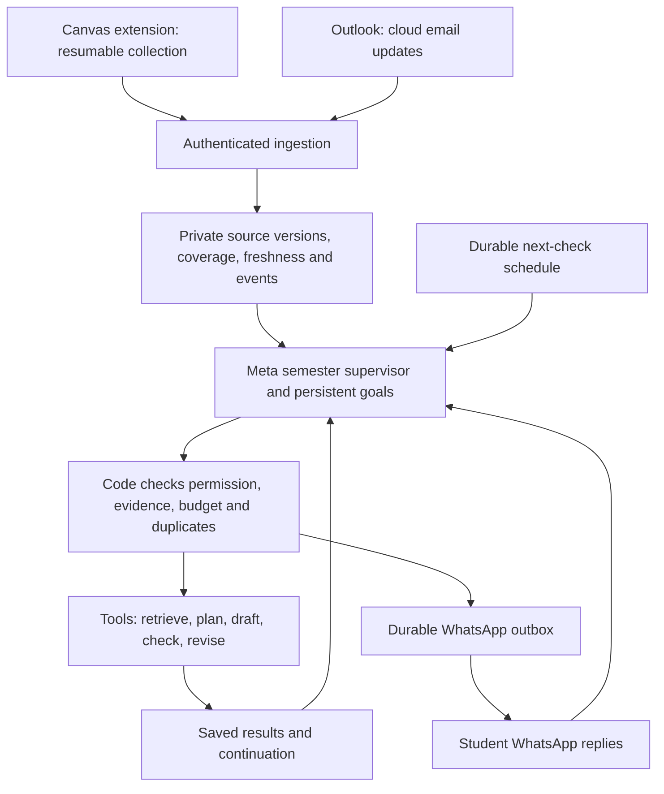

# Wrytely academic agent — build plan

Revision 7 · October 30, 2026 · Product owner: Akbar

This is the authoritative product scope and delivery order. It incorporates the
founder's Canvas-extension/Outlook decision and review of Claude's October 30 plan.
It supersedes revision 6, dated hackathon shortcuts, the old integration freeze,
and contradictory access assumptions in old stage documents. Planning does not
activate services, authorize account access/spending, or change executable contracts.

- [Step-by-step work orders and exact owners](WORK-ORDERS.md)
- [Code audit: keep, change, add, retire](IMPLEMENTATION-AUDIT.md)
- [Current evidence and blockers](../STATUS.md)
- [Ownership and coordination](../TEAM.md)
- [Implemented interfaces](../CONTRACTS.md)
- [Historical revision 6](archive/BUILD-PLAN-r6-2026-10-29.md)

## 1. Required outcome

Each college student has a private academic agent hosted by Wrytely. It discovers
coursework, understands the situation across courses, creates and changes its own
working plan, offers useful help, carries out delegated work, checks results, and
follows through. WhatsApp is the everyday conversation. The website handles signup,
connections, controls, course coverage and private results.

The student connects Canvas through our browser extension and connects Outlook email.
They do not paste each assignment or tell the agent every task. Meta models perform
the primary reasoning, investigation, planning, drafting and semantic review.
We keep our own Python runtime. Hermes replacement is deferred pending verified
rule compatibility and measured engineering benefit. We are not training a new model.

The completed first version must:

1. Discover accessible active Canvas courses without manual course IDs or a hard-coded
   course count. Prove competing priorities across at least two courses. Resource/rate
   limits and incomplete discovery must be visible rather than silently hiding courses.
2. Read accessible syllabus, modules/pages, assignment instructions and rubrics,
   effective student-specific due dates, announcements, discussion threads/replies,
   relevant files, grades and submission state. Report inaccessible/unsupported content.
3. Read authorized Outlook email and relevant attachments, associate academic evidence
   with its source, and detect email updates while the student's laptop is closed.
4. Find commitments, investigate missing details, prioritize across courses, create
   goals and next steps, and revise plans after new evidence or student replies.
5. Proactively offer help and report relevant changes through WhatsApp. Class reminders
   require evidenced class times and attendance rules; course names are not a timetable.
6. After delegation, retrieve actual requirements, prepare an appropriate draft or
   study/preparation result, check it, deliver a usable file, and revise it on request.
7. Follow work through ready-to-submit and observed submission, distinguish student
   reports from provider evidence, and preserve reopened or unresolved responsibilities.
8. Operate continuously on our servers, recover after failures, avoid duplicate work
   and messages, and remain private across students without requiring a website visit.

### Availability and freshness

The cloud agent stays available while the computer is off. Canvas collection requires
an available browser/device and usable Canvas login. First sync reads course by course;
later sync resumes on browser startup and targets roughly every 30 minutes while
available, with bounded batches and backoff. This is not a browser scheduling guarantee.
Weekly refresh is a fallback. If a Canvas tab must be open, report that requirement.

Outlook's authorized server connection is an independent update path, not proof that
all Canvas changes arrived. Store last attempt, last successful check and coverage per
resource. The agent requests a refresh when a decision needs newer information. It
must never invent unseen changes or claim the browser was available when it was not.

## 2. Scope

| Required first version                                           | Later expansion                                 |
| ---------------------------------------------------------------- | ----------------------------------------------- |
| Canvas extension, Outlook email, official WhatsApp Cloud API     | Teams and group chats                           |
| Automatic collection, semester supervisor, persistent goals      | Calendar authorization/free-time integration    |
| Investigation tools, adaptive scheduling and follow-through      | Wrytely handwriting service as an external tool |
| Checked drafts, Word/PDF files, revisions, study/lab preparation | Sandboxed code execution, iMessage, desktop app |
| Private signup, controls, account isolation, cost limits         | Institution-approved Canvas cloud OAuth         |

Outlook cannot silently move to later. Manual snapshots, Telegram and mock sources
cannot complete the required connectors/channel. They may assist development only
with an explicit product decision. Physical labs, in-person work and inaccessible
external course systems require honest partial assistance; never invent experiment
results, references, grades or submission evidence.

Automatic Canvas submission, discussion posting, email sending and classmate messaging
are outside this version. Reading Outlook does not authorize sending. Existing
course-policy/delegation checks remain until an explicit reviewed product change;
Claude's warning-only course-policy suggestion is not silently adopted.

## 3. Architecture

Plain code collects and compares evidence. Meta interprets the meaning and relevance
of a change, investigates details and chooses actions. The supervisor retrieves source
sections and prior results rather than relying only on a short semester summary.
It creates bounded tasks, examines results and continues until complete, waiting or
blocked. Goals and waiting reasons survive process restarts. Time-based reviews give
it opportunities to reassess; they do not prescribe every student's work. No useful
action means idle with a reason and optional next check, not invented busywork.

Example: Outlook receives an extension notice; the agent identifies its assignment,
checks conflicting dates, reprioritizes other work, cancels obsolete reminders,
explains the change, then carries an accepted draft through checks and delivery.
Uncertain source matching stays uncertain rather than overwriting another course.

## 4. Delivery order

Each [work order](WORK-ORDERS.md) has one accountable engineer, explicit dependencies,
file boundaries and observable acceptance. Independent tasks within a phase can run
in parallel after interface agreement. Akbar's engineering work is performed with Codex.

| Phase                  | Akbar + Codex                                                | Murtazo                                                            | Exit evidence                                                                                     |
| ---------------------- | ------------------------------------------------------------ | ------------------------------------------------------------------ | ------------------------------------------------------------------------------------------------- |
| P0: baseline/access    | Consolidate runtime, diagnose Meta, agree contracts/budgets  | Canvas feasibility, Outlook consent feasibility, WhatsApp delivery | Reviewed baseline and documented access results                                                   |
| P1: collect/remember   | Connection/sync storage, freshness, retrieval, change events | Pairing, Canvas collector, Outlook connector, connections UI       | Two-course automatic discovery plus Outlook ingestion; repeated/partial/restarted sync verified   |
| P2: autonomous service | Commitments, supervisor, schedules and action ledger         | Continuous processes, health and proactive offer transport         | Bounded laptop-closed live test; update causes agent-chosen offer; restart without duplicate work |
| P3: delegated work     | Intent, orchestration, checks, rendering, revision           | Buttons/free text, private file delivery, results UI               | WhatsApp acceptance → real Meta work → checked file → revision                                    |
| P4: adaptation         | Replanning, follow-through, progress/grade reasoning         | Submission/grade refresh, source status and controls               | Changes alter plans/drafts; observed submission ends correct reminders                            |
| P5: reliability/pilot  | Isolation/cost/adversarial/recovery evaluation               | Provider failure tests, deployment recovery and onboarding         | 72-hour bounded soak, three full runs, two-account isolation, student feedback                    |
| P6: release            | Evidence/model provenance and release recommendation         | Setup guide, demonstration assets, release preparation             | Reviewed release decision and truthful event submission if still eligible                         |

P0 access tests proceed alongside baseline review. Meta/WhatsApp failures block live
end-to-end gates, not independent source implementation. P2 can be developed against
fixtures but cannot pass without real collection and delivery. P3/P4 are required,
not optional deadline cuts. No calendar deadline changes this product definition.
Hackathon submission follows the event's actual rules/dates separately.

## 5. Data and control requirements

- Identity: verified Clerk identity owns connections. Extension pairing uses a short-lived
  one-use code and revocable ingestion credential. Posted user IDs never establish ownership.
  Canvas passwords/cookies stay in the browser, never our cloud or model context.
- Connection generations: disconnect/account switch invalidates old ingestion, actions
  and callbacks. Outlook tokens require encrypted server-side storage; the Canvas rule
  does not forbid securely storing authorized Outlook tokens. Decide retention/deletion
  behavior before pilot; update the approved privacy notice through review if needed.
- Source identity: student, connection, institution/mailbox, course and provider object.
  Use content digests plus provider metadata, not poll time, as revision identity.
  Keep source/student timezones and normalize comparison times to UTC.
- Coverage: full/partial/restricted/unsupported with counts, cursors and controlled errors.
  Missing on an incomplete scan does not mean deleted. Enrollment loss, failed access
  and confirmed deletion are separate states; preserve still-active responsibilities.
- Freshness: immutable content version is separate from last successful check. Unchanged
  reads update freshness without creating new work. Extension observations are authenticated
  client reports, not independent proof of provider truth; reject stale generations and
  implausible times. Stable syllabus and imminent deadlines need different freshness policies.
- Retrieval: retain original text/provenance; segment long documents and retrieve full
  relevant sections. Never treat eight sources or 6,000-character excerpts as whole-course
  coverage. Track file extraction failures, tables/images and unsupported material honestly.
- Commitments: merge Canvas/email representations of an assignment while preserving both
  sources. Not every discussion post is a task. Derive required readings, quizzes, labs and
  exams from evidence; unknown weight/date stays unknown. Model extraction is fallible.
- Delegation: offers bind current commitments/evidence. Validated acceptance grants bounded
  work; duplicate/stale/cross-account buttons cannot start it twice. Permission to draft
  and permission to deliver to the linked student are distinct. Silence cannot expand scope.
- Scheduling: persist next checks with revision/cancellation keys; coalesce related events
  and fairly share workers. Unchanged polls need no model call. Morning/weekly/deadline
  checks are adaptable defaults, within quiet hours and spending limits.
- Sending: reuse outbox/fences and signed evidence. Proactive offers/buttons/documents need
  reviewed payload contracts. Outside the reply window use an actually approved template.
  Acceptance is not delivery; ambiguous sends need reconciliation, not blind resending.
  Do not promise universally exactly-once external delivery.
- Budgets: reserve maximum estimated cost before calls. Account/global limits cover
  supervisor, drafting, reviews and retries and survive restart. Unknown usage retains its
  reservation until reconciled. Available credits do not increase authorized spending.
- Privacy: scope retrieval, tasks, artifacts, extensions, callbacks and logs per student.
  Imported course/email text cannot change permissions or request secrets. Validate file
  destinations and never execute imported HTML or attachments. Do not collect unrelated mail
  unnecessarily; disclose the actual authorized reading scope.

## 6. End-to-end proof

Use at least two controlled Canvas courses and an Outlook mailbox. Sign in, pair the
extension/WhatsApp and authorize email. Discover courses and actual syllabus/assignment
contents without manual IDs or paste. The agent chooses an important item and offers
help with a sourced reason. Accept; the agent independently creates/checks a draft and
delivers a file. Receive an Outlook update while the laptop is off; the agent changes
its plan and informs the student. Later Canvas sync confirms or conflicts with it.
Change a rubric; invalidate affected work, revise within consent, cancel old reminders.
Observe submission on a later sync and stop reminders for that assignment only.

Repeat with restarted services, paused/revoked access, duplicate events/buttons,
incomplete sync, expired login, overdue work and a second student. No manual message
may be needed to restart the supervisor. Three successful runs complement, not replace,
a 72-hour controlled soak and fault tests. Agree a hard soak budget before starting.
Fixtures prove logic; real runs prove integrations. Missing live artifact/delivery stays
an unverified gate. Grades need known weighting/rules; no invented precise pass forecast.

## 7. Repository, infrastructure and reporting

Reuse this new repository and existing suitable Wrytely service accounts with isolated
agent configuration/data. Existing production remains untouched. Current development
uses isolated Railway and Clerk development login. agent.wrytely.io remains the intended
address subject to release setup. Handwriting stays an external later tool; no copy of
the original private product. No extra cloud service is required just by this plan.

Consolidate reviewed code through protected-main review. Until then use the exact
integration baseline in STATUS.md, not stale main/team-integration. Do not mass-merge
constituent PRs, force-push shared history, automatically delete branches or bypass
human approval. Review parked A4 for reuse at P4 rather than applying it blindly.

Keep STATUS.md short with owner/step/evidence/blocker/next action. Historical reports
live in docs/archive. CONTRACTS.md describes actual behavior; future interfaces must
be labeled proposals. Old stage documents are context, not competing instructions.

## 8. External dependencies

| Gate                                                                 | Responsible person                              | Independent work                                                 |
| -------------------------------------------------------------------- | ----------------------------------------------- | ---------------------------------------------------------------- |
| Canvas extension permissions, consenting course scope, access result | Murtazo; Akbar provides access/consent          | Storage/events/fixtures                                          |
| Outlook consent or institutional approval                            | Murtazo; Akbar handles account/admin decisions  | Adapter and email fixtures; no claim of connection               |
| Meta failure and usage reconciliation                                | Akbar/Codex                                     | Source work and offline supervisor                               |
| WhatsApp business lock/templates/test recipients                     | Murtazo; Akbar handles legal/business decisions | Mock transport/status/intent tests                               |
| Continuous-run budget and deployment/release scope                   | Akbar                                           | Implement limits and recovery without activation                 |
| Interface agreement and independent review                           | Opposite engineer                               | Other owned unblocked steps                                      |
| Exact event model/framework/provenance rules                         | Akbar                                           | Keep Meta primary and log usage; no unsupported compliance claim |

Existing bounded approvals retain their original scope. P0 does not imply a new model
call allowance, a new credential, or a continuous worker release. New extension
installation/distribution, Microsoft app registration and live collection require the
appropriate specific account permissions when those steps are reached.
